<div align="center">

# 🎨 aw-paint

**A simple, modern paint app where you and your AI agents draw on the same canvas.**

[](LICENSE)


</div>

An applet for **Agent Web**. Draw with brush, eraser, shapes and text. Agents draw through a small tool API, and you watch their strokes appear live with an animated cursor.

## Demo

Agent strokes are drawn live, point by point. These two pictures were each made from a handful of `draw_line`, `draw_shape` and path calls.

<p align="center">
  
  
</p>

## Features

- **Paint:** brush, eraser, line, rectangle, circle, text, color, size, undo, clear, PNG export.
- **Agent tool API:** `draw_line`, `draw_shape`, `draw_text`, `clear`, `get_canvas`.
- **Live view:** agent strokes are animated as they arrive, with an agent cursor and a log line of the current call. You can keep drawing meanwhile.
- **Auto-correct mode:** snaps rough strokes to a clean line, circle, rectangle, triangle or letter (A-Z, 0-9). Rule-based and deterministic: the same input always gives the same output. No ML.
- **No dependencies.** Plain ES modules and Node 22.

## Quick start

aw-paint is an applet, not a standalone app. Put it in your Agent Web applets folder, then open:

```
/dapp/aw-paint/?project=<your-project>
```

The canvas is saved to `drawing/canvas.json` in that project.

## Agent tools

Run from the root of the project you are drawing in:

```bash
node <applet>/cli/draw.js list                      # tool schemas as JSON
node <applet>/cli/draw.js draw_line '{"x1":10,"y1":10,"x2":300,"y2":200,"color":"#ef4444"}'
node <applet>/cli/draw.js draw_shape '{"shape":"circle","geometry":{"cx":600,"cy":400,"r":80}}'
node <applet>/cli/draw.js draw_text '{"x":100,"y":100,"text":"HELLO","fontSize":60}'
node <applet>/cli/draw.js batch '[{"name":"clear","args":{}},{"name":"draw_line","args":{"x1":0,"y1":0,"x2":99,"y2":99}}]'
node <applet>/cli/draw.js get_canvas --png          # objects + drawing/canvas.png
```

| Tool | Arguments |
|---|---|
| `draw_line` | `x1, y1, x2, y2, color?, size?` |
| `draw_shape` | `shape` (line, circle, rectangle, triangle), `geometry`, `color?`, `size?`, `fill?` |
| `draw_text` | `x, y, text` (max 200 chars), `fontSize?, color?, size?` |
| `clear` | none (undoable) |
| `get_canvas` | none; `--png` also writes a PNG |

Output is one JSON line. Errors print `{"ok":false,"error":...}` and exit 1 without changing the canvas. `batch` is all-or-nothing.

## How it works

```
 you ──> src/app.js ┐
                  ├──> drawing/canvas.json  <── agent ── cli/draw.js
 live view <──────┘        (polled every 1 s)
```

User strokes pass through `lib/recognition/recognizer.js` when auto-correct is on. Both sides share the same pure modules in `lib/`. Details: [docs/DESIGN-drawing.md](docs/DESIGN-drawing.md).

## Develop

```bash
npm test
```

See [AGENTS.md](AGENTS.md) for the code layout and rules, and [docs/](docs/) for requirements and design.

## License

[MIT](LICENSE)
