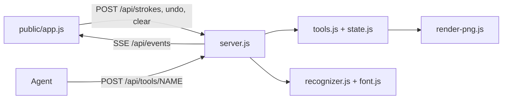

# Design: Drawing applet

Inputs: brief.md, docs/FEATURES.md, docs/REQUIREMENTS-drawing.md, mockup/index.html (look to keep). No AGENTS.md: conventions = Node 22, ESM-free CommonJS, no dependencies, `node --test`.

## Context
Paint app plus agent tool API plus deterministic shape/letter snapping. One shared canvas, server holds the state, browser renders it.

## Decision
- **Server-authoritative object list.** The canvas is an ordered list of objects `{id, type, color, size, points|geometry|text, source: user|agent}`. Undo, clear and snap are operations on this list, so they are the same for user and agent. The browser re-renders from the list (vector, not bitmap); the eraser is a white-colored stroke object (simple, undoable, deterministic).
- **HTTP JSON + SSE**, as in R7. No MCP in v1 (open question stays assumed HTTP; a thin MCP wrapper can call the same `tools.js`).
- **Pure modules** (`tools.js`, `recognizer.js`, `font.js`, `render-png.js`) have no I/O, so `node --test` covers them without a browser.
- **Recognition runs on the server** in `POST /api/strokes` (the user stroke commit), so results are identical for all clients and testable. The client sends the raw points and the auto flag; the server returns the stored object (snapped or raw).
- **Animation is client-side.** The server broadcasts one SSE event per agent call with the final object; the client interpolates points over `max(400ms, length/0.8 px/ms)`, moves `#cur`, writes `#log`. State is committed on the server immediately, so `get_canvas` is instant and the client still shows an animation. Local user strokes keep their order because the server sequence number (`seq`) orders everything; the client renders by list order.
- **PNG for get_canvas** is rendered on the server by a small rasterizer (`render-png.js`: line/circle/rect/triangle/text strokes onto an RGBA buffer, zlib deflate, hand-written PNG chunks with `zlib.crc32` on Node 22). Client PNG download uses `canvas.toBlob`.
- Canvas 1200x800 logical, scaled by CSS. Letters A-Z, 0-9 only.



### Endpoints
| Method/path | Purpose |
|---|---|
| GET / , /app.js, /style.css | static from `public/` (path-traversal safe) |
| GET /api/tools | schemas of 5 tools |
| POST /api/tools/:name | agent call; 200 `{ok,object?}` or 400 `{error}` |
| GET /api/canvas | `{width,height,objects,seq}` for browser sync |
| POST /api/strokes `{tool,color,size,points,auto}` | user stroke commit (recognizer if auto) |
| POST /api/undo, /api/clear | user ops (clear is one undoable entry) |
| GET /api/events | SSE: `object`, `undo`, `clear`, `agent_call` events each with `seq` |

### Recognizer (deterministic)
1. Resample stroke to 64 points by arc length; no randomness or time.
2. Closed if end-gap < 0.2 x path length. Open: line if max deviation from chord < 4% of length. Closed: circle if radius stddev/mean < 0.12; else polygon via Douglas-Peucker (epsilon 6% of bbox diagonal): 4 corners with near-right angles → rectangle (axis-aligned bbox), 3 corners → triangle.
3. Letters: strokes normalised to unit box, compared to `font.js` templates (polylines, resampled to 32 points) with mean point distance; accept if best score <= 0.18 and margin to second >= 0.02, else unchanged. Single-stroke input only in v1 (multi-stroke letters like E, T, X may be drawn in one go; templates are stored as single-path versions). Thresholds are constants documented in the file.
4. Output rounding to 1 decimal so results are byte-identical. Tie-breaks by fixed template order.

## Consequences
- + Same logic for user and agent; easy tests; no deps.
- + Vector state makes undo/clear trivial and the snap one undo step.
- − A server-side rasterizer is extra code (text uses the stroke font only, not system fonts); get_canvas PNG is approximate to the browser look.
- − Single shared canvas, no auth, lost on restart.
- − Single-stroke letters limit recognition (E, T, X must be drawn continuously). Accepted for v1.

## Risks
| Risk | Mitigation |
|---|---|
| Letter recognition below 90% | fixtures made from the same font with seeded noise (a fixed PRNG in the test only); tune the threshold; restrict the fixture set to A, E, L, O, T, X, 1 for the gate |
| Circle vs rounded rectangle confusion | the order of checks and the fixtures; tune constants |
| SSE behind proxies | heartbeat comment every 15 s; client auto-reconnect and resync from /api/canvas |
| PNG rasterizer scope creep | lines only (Bresenham with thickness), shapes composed of lines; no antialiasing |
| Windows vs Linux | no shell scripts in shipped code, `path.join`, env config |

## Files
```
package.json  Dockerfile  .dockerignore  server.js
src/state.js src/tools.js src/recognizer.js src/font.js src/render-png.js
public/index.html public/style.css public/app.js
test/*.test.js
```

## Tasks
Order is sequential unless marked parallel. Test command: `node --test`.

**T1 Scaffold and static server**
Files: package.json (no dependencies, scripts start/test), server.js, public/index.html (copy of the mockup markup), public/style.css, .dockerignore.
Accept: A1, A13; listens on 0.0.0.0:$PORT (default 3000); static serving rejects `..`. Test: test/server.test.js starts on port 0 and GETs `/`, `/../package.json` (404).

**T2 State and tools** (after T1)
Files: src/state.js, src/tools.js, test/tools.test.js.
Accept: A3, A4, A5; the five tools validate (finite numbers within canvas, known shape, text <= 200 chars, hex color), 400 error and unchanged state on bad input; undo/clear undoable multi-level; `get_canvas` returns size, objects, png (can be a stub until T6).
Test: `node --test test/tools.test.js`.

**T3 HTTP API and SSE** (after T2)
Files: server.js (routes only), test/api.test.js.
Accept: R7, R8, A6 server side: /api/tools, /api/tools/:name, /api/canvas, /api/strokes, /api/undo, /api/clear, /api/events emit an event with `seq` per change; heartbeat.
Test: api test with `http` module reads one SSE event after a POST.

**T4 Recognizer shapes** (parallel with T2/T3; files disjoint)
Files: src/recognizer.js, test/recognizer.test.js, test/fixtures.js.
Accept: A7, A9, A10 (function is only called when auto is on), A11; line/circle/rectangle/triangle in at least 95% of the fixed fixtures, scribble unchanged, two runs byte-identical.
Test: `node --test test/recognizer.test.js`.

**T5 Letters** (after T4)
Files: src/font.js (A-Z, 0-9 polylines; also used by draw_text and the rasterizer), src/recognizer.js (letter matcher), test/letters.test.js.
Accept: A8 (A, E, L, O, T, X, 1 at 90% or more), thresholds documented, ambiguous input unchanged.
Test: `node --test test/letters.test.js`.

**T6 PNG renderer** (after T5, T2)
Files: src/render-png.js, src/tools.js (wire get_canvas), test/png.test.js.
Accept: get_canvas returns a valid PNG data URL (signature and IHDR 1200x800 verified), a drawn line changes pixels.
Test: `node --test test/png.test.js`.

**T7 Wire the recognizer into strokes** (after T3, T5)
Files: server.js (the /api/strokes call only), test/api.test.js.
Accept: R11, R13: with auto=true a noisy circle is stored as one circle object, undo removes it in one step; auto=false stores raw points.
Test: `node --test test/api.test.js`.

**T8 Front end paint** (parallel with T4-T7 after T3; touches only public/)
Files: public/app.js, public/index.html, public/style.css.
Accept: A2, R1-R4, R11 toggle/badge; render from /api/canvas objects; tools brush/eraser/line/rect/circle/text; undo/clear call the API; PNG download; matches mockup look.
Test: manual checklist in docs/TEST notes; plus `node --check public/app.js`.

**T9 Live agent animation** (after T8)
Files: public/app.js.
Accept: A6, R9, R10; an SSE `object` event with source agent animates for at least 300 ms with the `#cur` cursor and `#log` line; user drawing meanwhile is kept; reconnect resyncs. The "Agent draws" button calls the draw tools with a demo drawing.
Test: manual in browser; API side is already covered.

**T10 Docker and docs** (after T1; parallel with others)
Files: Dockerfile (node:22-alpine, `COPY`, `ENV PORT=3000`, `EXPOSE 3000`, `CMD ["node","server.js"]`), README.md (API examples).
Accept: A12 `docker build` and `docker run -e PORT=8080 -p 8080:8080` answers GET /.
Test: build and curl.

File overlap: T3 and T7 both edit server.js, so they are sequential. T4/T5 touch recognizer.js sequentially. T8/T9 only public/.

## Open decisions (defaults used)
HTTP only (no MCP), one shared canvas, 1200x800, A-Z/0-9, triangle without a toolbar button. Tell the Architect if any change.

## Build status (Builder)
- [x] T1-T10 implemented. Files: package.json, Dockerfile, .dockerignore, server.js, src/{state,tools,shapes,font,recognizer,render-png}.js, public/{index,style,app}, test/{api,recognizer}.test.js. `node --test`: 10 pass.
- Deviation: added src/shapes.js (paths for all object types; client and PNG just draw `paths`). Letter tests are in recognizer.test.js (no separate letters.test.js). README.md not written; Docker build not run (docker not exercised). Browser animation untested manually.

> **Superseded (2026-10-28):** the server/REST/SSE parts are replaced by the applet port, see AGENTS.md. Recognizer constants still apply (now `lib/recognizer.js`).
