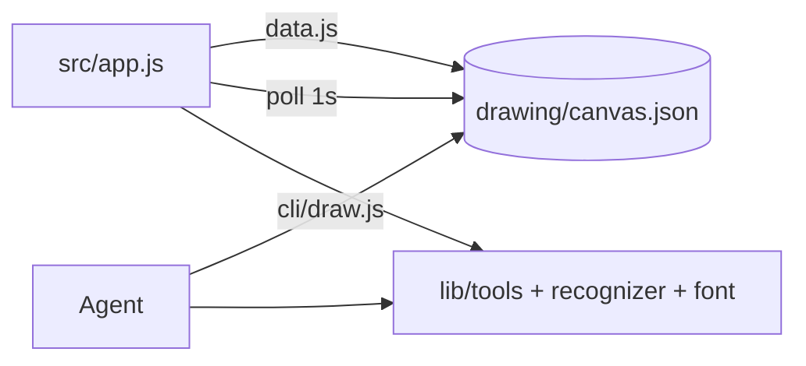

# Design: Drawing applet

Agent Web applet (see AGENTS.md and APPLET-CONTRACT.md). No server of its own.

## Architecture
- The canvas is one JSON document, `drawing/canvas.json`, in the open project: ordered vector objects `{id,type,color,size,points|geometry|text,source:user|agent}` plus `seq`, `history` (30 undo steps) and `lastCall`. Eraser = white stroke object.
- The applet (`src/app.js`) reads and writes it through `data.js` (host `/api/fs/read`, `/api/fs/write`) and polls every 1 s while visible.
- Agents use `cli/draw.js` (draw_line, draw_shape, draw_text, clear, get_canvas, list, batch, undo), which edits the same file. Batch is all-or-nothing.
- Live view: new `source:"agent"` objects are animated client-side with the agent cursor; the log shows `lastCall`.
- `lib/` modules are pure (no DOM, no I/O) so `npm test` covers them without a browser. `cli/render-png.js` rasterizes PNGs for agents (CLI only).
- Canvas 1200x800 logical. Letters A-Z, 0-9 only.

### Recognizer (deterministic)
1. Resample stroke to 64 points by arc length; no randomness or time.
2. Closed if end-gap < 0.2 x path length. Open: line if max deviation from chord < 4% of length. Closed: circle if radius stddev/mean < 0.12; else polygon via Douglas-Peucker (epsilon 6% of bbox diagonal): 4 corners with near-right angles → rectangle (axis-aligned bbox), 3 corners → triangle.
3. Letters: strokes normalised to unit box, compared to `font.js` templates (polylines, resampled to 32 points) with mean point distance; accept if best score <= 0.18 and margin to second >= 0.02, else unchanged. Single-stroke input only in v1 (multi-stroke letters like E, T, X may be drawn in one go; templates are stored as single-path versions). Thresholds are constants documented in the file.
4. Output rounding to 1 decimal so results are byte-identical. Tie-breaks by fixed template order.

## Known limits
- Single-stroke letters only (E, T, X must be drawn in one go).
- Agent PNG is approximate (stroke font, no antialiasing).
- Updates reach the UI by polling (see NEEDS.md).
